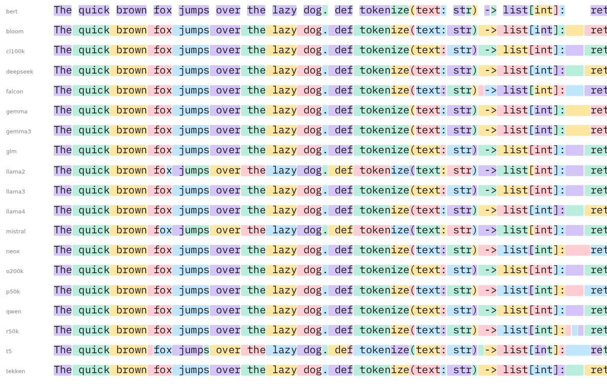

# font-idea

Absurd OpenType experiments built on top of IBM Plex. Two projects live here:

1. **Tokenizer font** (first): a color font whose GSUB rules approximate a BPE
   tokenizer, so tokens are highlighted as you type. `fonts/tokenizer/`
2. **The absurd ligature font** (later): hundreds of contextual substitutions
   keyed to common words and phrases, so no two documents look like the same
   font. `fonts/absurd/`

`fonts/smoke/` is a pipeline test: it turns the word "fire" red, respecting
word boundaries, using the same three mechanisms both real projects need
(new composite glyphs, chained contextual substitution, COLR/CPAL color).

## Tokenizer Mono

`fonts/tokenizer/recipe.py` builds one face per tokenizer vocabulary. They
share the typographic family name "Tokenizer Mono" (name IDs 16/17), so Font
Book and most font pickers show one family with a style per tokenizer; the
legacy family name (ID 1) and the file name carry the variant.

| variant  | vocabulary                              | used by |
|----------|-----------------------------------------|---------|
| cl100k   | cl100k_base                             | OpenAI GPT-4, GPT-3.5, text-embedding-3; also Phi-4, OLMo 2 |
| o200k    | o200k_base                              | OpenAI GPT-4o, o1, o3, GPT-4.1, gpt-oss |
| p50k     | p50k_base                               | OpenAI Codex, text-davinci-002/003 |
| r50k     | r50k_base                               | OpenAI GPT-2, GPT-3 |
| llama4   | unsloth/Llama-4-Scout-17B-16E-Instruct  | Meta Llama 4 |
| llama3   | NousResearch/Meta-Llama-3-8B            | Meta Llama 3 / 3.1 / 3.2 / 3.3 |
| llama2   | NousResearch/Llama-2-7b-hf              | Meta Llama 2 (SentencePiece) |
| gemma3   | unsloth/gemma-3-4b-it                   | Google Gemma 3 |
| gemma    | unsloth/gemma-2-2b                      | Google Gemma 1 / 2 |
| mistral  | unsloth/mistral-7b-v0.3                 | Mistral 7B v0.3 (SentencePiece) |
| tekken   | unsloth/Mistral-Nemo-Base-2407          | Mistral Nemo, Mistral Small 3 (Tekken) |
| qwen     | Qwen/Qwen2.5-7B                         | Alibaba Qwen 2 / 2.5 / 3 |
| deepseek | deepseek-ai/DeepSeek-V3                 | DeepSeek V3 / R1 |
| glm      | zai-org/GLM-4.5                         | Zhipu GLM-4.5 |
| neox     | EleutherAI/gpt-neox-20b                 | EleutherAI GPT-NeoX, Pythia |
| falcon   | tiiuae/falcon-7b                        | TII Falcon |
| bloom    | bigscience/bloom                        | BigScience BLOOM (multilingual) |
| t5       | google-t5/t5-base                       | Google T5 (SentencePiece Unigram, not BPE) |
| bert     | bert-base-cased                         | Google BERT (WordPiece; ## continuations approximated) |

Phi-4 and OLMo 2 use cl100k's vocabulary, gpt-oss uses o200k's, Qwen 3 uses
Qwen 2.5's, so those faces double up. Kimi K2 and Cohere don't publish a
downloadable `tokenizer.json`. Anthropic's tokenizer is not public, so there is no Claude face.

How it works, all inside the `calt` feature:

1. **TOK**: one chained-contextual rule per vocabulary token (2 to 16
   printable-ASCII characters), longest first, keyed on the first glyph. A
   match rewrites the letters to shape variants: `.s` start, `.m` middle,
   `.e` end. HarfBuzz skips past a matched rule, which gives greedy
   longest-match for free. Leftover plain letters become `.x` (single).
2. **FSM**: a 22-rule state machine with one glyph of lookback paints colors.
   A continuation inherits its left neighbour's color; a new token takes the
   color after the previous token's end. Five colors cycle, so neighbours
   never share one.
3. **COLR v0**: every colored variant is a composite of the original letter
   (so it degrades to plain text without color support) with two layers: a
   box in palette slot *k* and the letter in the text color. Palette 0 is for
   light backgrounds, palette 1 for dark (`font-palette` in CSS).

Greedy longest-match is not BPE, so on top of the vocabulary rules the recipe
adds **whole-word rules**: the top 60,000 English words (wordfreq) in the
forms " word", " Word", line-initial "word" and, for the top 20,000, " WORD",
each tokenized by the real tokenizer in context. A rule is only emitted where
greedy would split differently, so they cost nothing where greedy is already
right. On the mixed corpus this took cl100k from 94.7% to 97.4% boundary
precision. What's left is rare words outside the list and code identifiers.

Every character Plex Mono has a glyph for is covered (1,001 characters: ASCII,
Latin-1, Latin Extended-A, curly quotes, dashes, currency...), so "café" and
“quoted” text tokenize like the real thing.

### Accuracy

Boundary agreement with the real tokenizer on the corpus described below,
from the CI run of the current build (sorted by precision):

| face | precision | recall | tokens font / real | shaping | TTF |
|---|---|---|---|---|---|
| r50k | 98.6% | 98.7% | 3091 / 3088 | 67 µs/char | 8.6 MB |
| bert | 98.6% | 96.7% | 2595 / 2645 | 1 µs/char | 2.5 MB |
| gemma | 98.2% | 98.1% | 2262 / 2264 | 62 µs/char | 14.5 MB |
| p50k | 98.1% | 98.3% | 2406 / 2403 | 44 µs/char | 8.6 MB |
| neox | 98.1% | 97.8% | 2331 / 2338 | 61 µs/char | 8.8 MB |
| gemma3 | 98.0% | 98.0% | 2273 / 2274 | 57 µs/char | 13.8 MB |
| mistral | 97.6% | 98.0% | 2480 / 2470 | 69 µs/char | 8.6 MB |
| llama2 | 97.6% | 97.3% | 2508 / 2514 | 68 µs/char | 8.8 MB |
| qwen | 97.5% | 97.3% | 2178 / 2181 | 64 µs/char | 11.1 MB |
| cl100k | 97.4% | 97.3% | 2150 / 2153 | 54 µs/char | 10.8 MB |
| llama3 | 97.3% | 97.2% | 2152 / 2153 | 65 µs/char | 11.3 MB |
| o200k | 97.2% | 97.3% | 2148 / 2146 | 72 µs/char | 13.1 MB |
| glm | 97.1% | 96.4% | 2139 / 2156 | 69 µs/char | 11.7 MB |
| deepseek | 96.8% | 96.9% | 2250 / 2247 | 61 µs/char | 9.9 MB |
| falcon | 96.7% | 98.0% | 2524 / 2492 | 61 µs/char | 9.1 MB |
| llama4 | 96.6% | 96.7% | 2158 / 2156 | 42 µs/char | 13.6 MB |
| tekken | 96.5% | 96.5% | 2282 / 2281 | 69 µs/char | 11.2 MB |
| bloom | 93.2% | 93.8% | 2236 / 2221 | 76 µs/char | 12.9 MB |
| t5 | 83.0% | 92.7% | 2854 / 2556 | 28 µs/char | 7.1 MB |

The two odd ones are explained by their algorithms: BLOOM is multilingual and
its English/code vocabulary collides with tokens from other languages; T5 is
a Unigram model that picks splits by likelihood, which no longest-match
scheme can reproduce. BERT is WordPiece, which really is greedy
longest-match, so it needs no word rules at all.

### How accuracy is measured

`make tokcheck` shapes every line of `fonts/tokenizer/corpus-large.txt` with
HarfBuzz (the engine Chrome uses) and reads back which glyphs came out as
start-of-token variants. That is the font's set of token boundaries, as
character positions. The real tokenizer (tiktoken or Hugging Face
`tokenizers`) is run on the same line for its boundaries, and the sets are
compared:

- **precision**: of the boundaries the font drew, the share the real
  tokenizer agrees with (low when the font over-splits);
- **recall**: of the real boundaries, the share the font drew (low when it
  under-splits).

Only boundaries are compared because that is all the font can be right or
wrong about; it never knows token IDs. The corpus is about 200 lines of
English prose (including the OFL license text), Python from the standard
library, some JavaScript and SQL, and a few lines with curly quotes, accents
and currency symbols. Nothing in it was used to build the fonts: the word
rules come from a frequency list. Each line is tokenized on its own, which
matches how browsers shape text. A different corpus would move the numbers
by a point or two, and a multilingual vocabulary like BLOOM is judged here
only on its English and code tokens. CI prints the table for every face on
every push.

Rendering notes learned the hard way:

- Translucent boxes show seams where neighbours overlap, so the colors are
  opaque.
- Chrome draws a COLR layer shifted left by its own xMin, so every box starts
  at x=0 and the inter-token gap sits entirely on the right of the end box.
- Chrome snaps color-glyph bitmaps to whole pixels, so a continuing box must
  overlap the next glyph by more than one device pixel at the smallest size
  you care about (120 units here), or its anti-aliased edge column shows as
  a seam. The overlap is always hidden under the next glyph's own box.
- Verified in Chromium (headless, pixel-checked) and Safari (by eye).
  Firefox not yet checked.
- `tools/gallery.py` renders one line per variant; `tools/shot.py` renders
  any built font. Both use Playwright's cached Chromium headlessly.

## Setup

    make setup          # venv + pip deps, downloads Plex into vendor/ (gitignored)
    make smoke          # build/smoke/SmokeMono-Regular.{ttf,woff,woff2}
    make test           # shape a sentence with HarfBuzz and print glyph names
    make tokenizer      # all tokenizer variants (V=o200k for one), ~30 s each
    make tokcheck       # fidelity vs the real tokenizers (V=o200k for one)
    python3 -m http.server   # then open http://localhost:8000/demo/tokenizer.html

## How a build works

`tools/build.py fonts/<name>` loads `fonts/<name>/recipe.py`, opens the Plex
TTF it names, hands it to the recipe along with a `FontKit` (`tools/fontkit.py`),
then renames and exports. The kit:

- adds glyphs as composites of existing outlines, so no outline drawing needed;
- compiles OpenType feature code with feaLib and appends the resulting lookups
  to Plex's existing GSUB, so Plex's own features (ss01, frac, zero...) survive;
- builds COLR v0 + CPAL from per-glyph layer lists.

`tools/shape.py  "<text>"` prints the shaped glyph names. That is the
unit test for substitution rules.

Outputs are TTF, WOFF, WOFF2. There is no CFF/OTF output: composite glyphs
only exist in TrueType outlines, and TTF-in-.otf is just a rename.

## CI and releases

`.github/workflows/build.yml` builds every variant in parallel on each push
to `main`, runs the fidelity check into the job summary, and uploads a
`tokenizer-mono-fonts` artifact (fonts, manifest, demo page, in the repo's
layout so `demo/tokenizer.html` works from the unzipped folder). Pushing a
`v*` tag also creates a GitHub release with the zip attached:

    git tag v0.1.0 && git push origin v0.1.0

## Naming

IBM Plex is OFL-licensed with "Plex" as a Reserved Font Name, so derived fonts
must not use it. Each recipe sets its own `FAMILY`.
